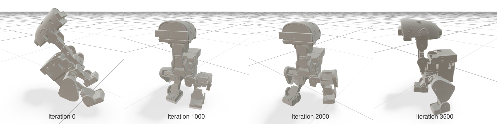
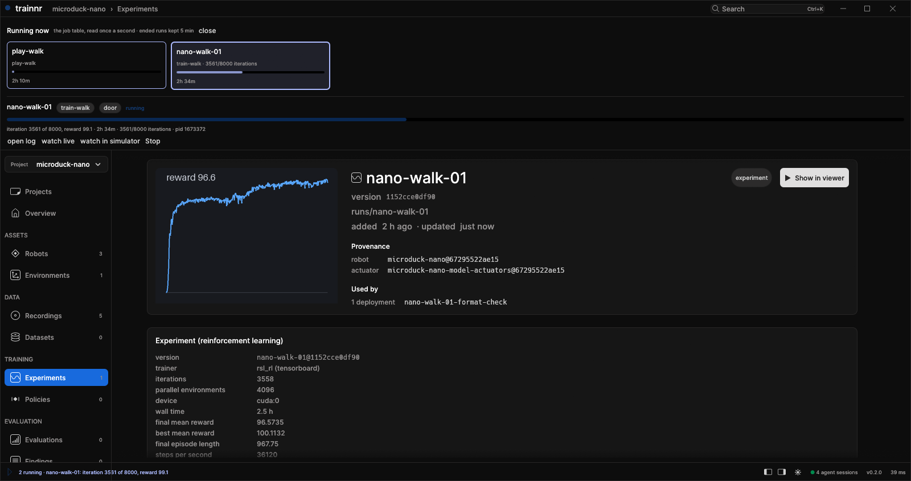
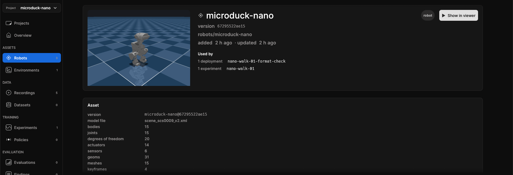
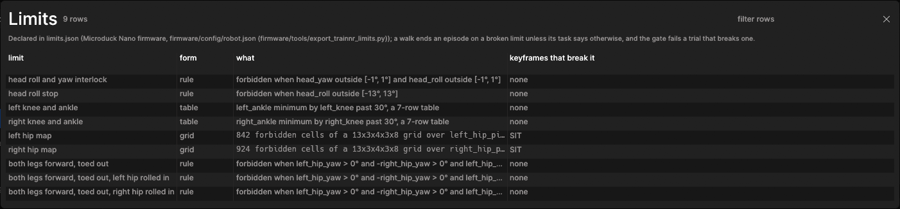
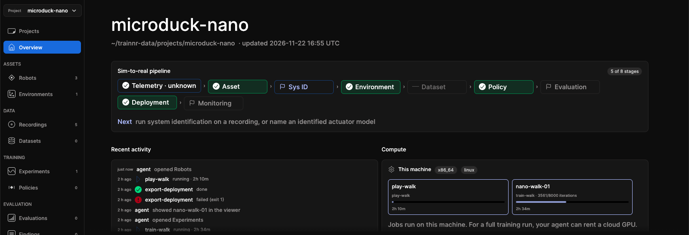

# The sim-to-real pipeline

How a walking policy gets from simulation to the robot, through trainnr (used through its MCP tools only) and this
repository's runtime. Status on 2026-11-23.

trainnr project: `microduck-nano` (under trainnr's data folder, not in this repository). The robot is onboarded from
the design repository's `sim/scene_scs0009_v2.xml` with this repository's `limits.json` beside it (below): as
`microduck-nano@67295522ae15` on the machine that trains. Earlier entries in the project
(`microduck-nano-2026-11-18@e936681498c1`, `microduck-nano-v2@a415da90611d` on the machine the pipeline check ran
on) are the same model at earlier dates, from when trainnr wanted a new name for each revision
([trainnr#119](https://github.com/Trainnr-AI/trainnr/issues/119); the fix was not yet on trainnr's main branch on
2026-11-22).

**The firmware's limits over several joints go to trainnr as a file.** The firmware enforces more than one range
per joint (each leg's hip map, knee x ankle, both legs, head roll x yaw; [firmware.md](firmware.md)). Since
[trainnr#121](https://github.com/Trainnr-AI/trainnr/issues/121) (fixed 2026-11-22) trainnr reads such limits from
a `limits.json` beside the model: a walk ends an episode on a pose they forbid, the evaluation counts them, and the
gate fails a policy that breaks one. `firmware/tools/export_trainnr_limits.py` writes that file from
`firmware/config/robot.json` (nine limits: two rules for the head, a table per leg for knee and ankle, a grid per
leg for the hip map, three rules for both legs), and `make -C firmware/tests test` compares it with the firmware's
own verdict on 60,000 poses, rule by rule. To onboard the robot:

```
cp <design>/sim/scene_scs0009_v2.xml <design>/sim/robot_scs0009_v2.xml <folder>/ && cp -r <design>/sim/assets <folder>/
python3 firmware/tools/export_trainnr_limits.py --out <folder>/limits.json
onboard_robot("<folder>/scene_scs0009_v2.xml", "microduck-nano")
```

What trainnr does not do yet is hold a limb where it is when a command would break a limit, as the firmware does:
in training the episode ends instead.

| Stage | trainnr tool | Here | Status |
|---|---|---|---|
| 1. Robot model | `onboard_robot` | | done: 16 bodies, 15 joints, 14 actuators; the names a walk needs (`trunk_base`, `left_foot` / `right_foot` sites, `*_foot_collision`, `imu` with a gyro) |
| 2. Telemetry | `ingest_recording` (MCAP) | `duckd run --record`, `duckd bench --record` | works from the real board: `board-at-rest-2026-11-22@8c0bbb7927db` (20 s, nothing armed, one servo on the bus: joint positions and speeds at 50 Hz; no IMU messages, because the firmware reports no IMU until its mounting matrix is set). Since 2026-11-23 also one servo moving on the bench: six recordings of an SCS0009 with a bare horn, steps and chirps (`scs0009-bare-horn-steps-a30-2026-11-23@bd03836aefcd` and five beside it; [what they show](../../scripts/servo-bench/README.md)) |
| 3. Actuator model (SCS0009) | `identify_system`, method `servo-bench` | bench checklist 8b | what is known without a fit is in [scs0009.md](../project/scs0009.md): the model's actuators are Feetech's datasheet at 5 V, and one servo's measured speed is within 4 % of it. Open on our side: trainnr fits a servo's model from a bench recording since 2026-11-22 ([trainnr#101](https://github.com/Trainnr-AI/trainnr/issues/101)). It wants one servo driving an arm of known mass and length, its commanded and measured position, steps and chirps, 12 s or more a recording, two or three arm masses. The recording side works since 2026-11-23 (`duckd bench`, bare horn); with nothing on the horn there is no torque to fit, so the arm is what is missing. `scripts/servo-bench/make_pendulum.py` writes the bench from the arm's measurements. Tried on 2026-11-24 with the bare horn as its own bench (`scs0009-bench-bare-horn@d7f0cdfb324e`): `identify_system` refused the recording, because trainnr reads an MCAP's `/joint_commands` under another name than the fit looks for ([trainnr#147](https://github.com/Trainnr-AI/trainnr/issues/147)). A fit of an unloaded servo with the datasheet's stall torque declared is asked for as [trainnr#148](https://github.com/Trainnr-AI/trainnr/issues/148) |
| 4. Walk environment | `create_task`, family `trainnr/legged-walk` | | done: `nano-walk` (`legged-walk@091af4e9f626`): our robot, the model's own actuators (`actuator: model`, recorded by trainnr as declared, not identified), neck and head held at the stand pose, the ten leg joints driven, the limits ending episodes. `check_task` accepted it ([trainnr#100](https://github.com/Trainnr-AI/trainnr/issues/100), fixed 2026-11-22) |
| 5. Train | `train_walk` | | blocked on the walk's reward ([trainnr#146](https://github.com/Trainnr-AI/trainnr/issues/146), below). First run done 2026-11-23: experiment `nano-walk-01@1152cce0df90` (8,000 iterations, 6 h 41 min on an RTX 3090 Ti with other work sharing it). It trained on a servo nobody has measured, so it shows that the pipeline carries our robot, not that the robot will walk. On a Mac's CPU a full run would take about 12 days |
| 6. Evaluate | `evaluate_walk` | | done for that run's last checkpoint: `nano-walk-01-model_7999-cuda-seed1000-n40-pba3716@5d75216b5c88`. It stayed up in 40 of 40 trials and tracked the command in none, so 0 of 40 are a success (95 % interval 0 to 0.09). Not a policy to deploy; stages 7 to 9 have not been run on it |
| 7. Export | `export_deployment` | | works: `policy.onnx` + `deploy.json` (`trainnr-deploy/1`) |
| 8. Sim-to-sim gate | `gate_deployment` (runtime `mujoco`) | | works; passes only a policy whose evaluation demonstrated a success ([trainnr#108](https://github.com/Trainnr-AI/trainnr/issues/108), fixed upstream 2026-11-15; needs a trainnr plugin from after that date) |
| 9. Preflight | `preflight_deployment` | | works: refused the pipeline-check policy for targets 1.5 rad past a joint's range, as it should |
| 10. On the robot | | `duckd run --policy DEPLOYMENT [--command FORWARD,SIDEWAYS,TURN] [--listen DEVICE]` | `duckd` reads the export as trainnr wrote it; on the board 0.40 ms per inference. The command is refused outside the ranges the policy was trained on. The firmware's own limits, interlocks and faults stay underneath |
| 11. Drift | `check_drift` | `duckd run --record` | ready once 2 has real data |

## 2026-11-22: our robot trains

- **The model is the design's latest.** The design repository's `main` (`364eea5`) changed the bay, the head's
  cable route and the assembly order after the model was first onboarded, not the simulation files. The simulation
  therefore does not yet have the lid and the UNO Q 3 mm higher (the real battery is 60 mm, not 57), and most of
  its electronics masses are still assumed, not weighed.
- **trainnr can now walk any onboarded legged robot** (trainnr#100, #101 and #121, fixed that day). The robot was
  onboarded again with `limits.json`, the walk `nano-walk` declared and accepted, a smoke run passed, and the full
  run `nano-walk-01` started. All of it is in the project and shows in the trainnr Studio.
- **The policy drives ten joints, not fourteen.** Neck and head are held at the stand pose in training, and
  trainnr's export says so (`joints.action_joints` in `deploy.json`). `duckd` follows it since that day: such a
  policy still observes fourteen joints, its last action is ten wide (47 values in all), and the four joints it
  does not drive get the stand pose as their target. Tested against a `deploy.json` trainnr wrote for a head-held
  walk on a copy of this model, and by hand on a tiny network. The run's first checkpoint, exported unevaluated
  as `nano-walk-01-format-check` only to see the format, loads in `duckd` (47 values in, 10 out); it is not a
  policy.
- **A run can be filmed.** `play_walk(experiment="nano-walk-01", checkpoint="all", viewer="film")` films every
  checkpoint without a window ([trainnr#137](https://github.com/Trainnr-AI/trainnr/issues/137), fixed that
  night): one world, one seed, a held command of 0.4 m/s forward, 10 s or until it falls. Each lands beside the
  run as `play-model_N/play.mp4` with `play.json`, and all of them in order as `film.mp4`. Of the 28 checkpoints
  up to iteration 6,750, the untrained one falls after 0.76 s and three later ones (2,500, 3,750, 4,750) fall
  after about 6 s; the others walk the 10 s. From iteration 2,250 on they cover 1.7 to 2.0 m, half of what the
  command asks. One seed each: a look, not an evaluation. The films are 640x480 with no setting for the size
  ([trainnr#142](https://github.com/Trainnr-AI/trainnr/issues/142)).
- **The first run stands and steps; it does not follow the command.** The films and the evaluation agree: no
  falls in the evaluation's 40 trials, and about half the commanded speed at best. What to change (the reward
  weights were tuned for Pollen's microduck, the servo is not measured, the command range may be more than this
  robot can do) is not decided.
- **A recording that names the beak cannot be fitted.** `identify_system` with `legged-joints` refuses the whole
  recording because `beak` is a servo on the robot and not a hinge of the model
  ([trainnr#133](https://github.com/Trainnr-AI/trainnr/issues/133)). Fixed upstream the same night (the fit now
  runs on the joints the model has); not tried here yet. It will matter when the assembled robot is recorded
  moving.

## 2026-11-23: towards a walk that follows its command

- **A second run asks for less.** The first run covered half the distance its command asked for. To tell a robot
  that cannot go faster from a reward that does not make it, the task `nano-walk-half` (`legged-walk@1092bd21b650`)
  is the same walk with every command range halved (forward +-0.2 m/s, sideways +-0.15 m/s, turning +-0.5 rad/s),
  and the run `nano-walk-02-half@c80ea7edfae7` trained it for 2,300 iterations (57 minutes with the GPU to
  itself).
- **It stands still, and is paid for it.** Asked for 0.2 m/s, every checkpoint from iteration 250 on stays on its
  feet for the 10 s of its film and covers 0.01 to 0.04 m. Evaluation
  `nano-walk-02-half-model_2299-cuda-seed1000-n40-pdb7565@6c87487c70b4`: stayed up in 40 of 40 trials, tracked
  the command in none, median error as large as the command itself. Its tracking reward in training is higher
  than the first run's. So it is the reward, not the robot: trainnr's walk pays `exp(-error^2 / 0.1)` for forward
  and sideways speed, a tolerance of 0.32 m/s taken from Pollen's microduck and not a setting. Standing still
  under a 0.2 m/s command earns two thirds of it; so does walking at 0.2 m/s under a 0.4 m/s command, which is
  where the first run settled. Reported as [trainnr#146](https://github.com/Trainnr-AI/trainnr/issues/146). Until
  that tolerance can be set, or follows the command range, more training of this walk will not give a robot that
  goes where it is told, and all that is known of this robot's speed is that the simulated one managed 0.19 m/s
  when nothing asked more of it.
- **A third run is only ever asked to go forward fast.** If standing still pays under small commands, a task
  that never gives one cannot be satisfied by standing: `nano-walk-fast` (`legged-walk@768f0d96cc36`) asks for
  0.3 to 0.6 m/s forward (sideways +-0.1 m/s, turning +-1 rad/s), on the model's actuators, which are Feetech's
  datasheet at 5 V ([scs0009.md](../project/scs0009.md)), with `dr_span: 0.03` set and without effect
  ([trainnr#150](https://github.com/Trainnr-AI/trainnr/issues/150)). The run is `nano-walk-03-fast@f732e105c32c`, 2,300
  iterations. A policy from it cannot be asked to stand still.
- **It tops out at 0.19 m/s, whatever it is asked.** Asked for 0.6 m/s, the third run's checkpoints from
  iteration 1,500 on cover 1.7 to 1.9 m in 10 s: the same 1.9 m the first run covered when asked for 0.4 m/s.
  Evaluation `nano-walk-03-fast-model_2299-cuda-seed1000-n40-p41878d@f66d94cd14a9`: stayed up in 40 of 40,
  tracked in none, median error two thirds of the command. Under a 0.6 m/s command the reward pays little for
  0.19 m/s and would pay much more for going faster, and training still stopped there, so this is a ceiling of the
  simulated robot under this walk's terms and not laziness. That corrects the reading of the first run above:
  its half speed was this ceiling, not the tolerance. What sets it is not known: the servo's 500 deg/s and
  0.19 N m, the stride the limits allow, or the walk's own gait terms (the foot's time in the air, the pose it is
  held near), which are also Pollen's microduck's. The tolerance still explains the second run (it stands), and
  a walk that goes where it is told inside 0 to 0.2 m/s still needs trainnr#146.
- **What trainnr cannot train for this robot yet**, both asked for upstream: a reference motion (sit, stand, a
  stamp: [trainnr#144](https://github.com/Trainnr-AI/trainnr/issues/144); its tracking is for one humanoid), and
  a walk during which something else moves the head
  ([trainnr#145](https://github.com/Trainnr-AI/trainnr/issues/145)).

- **A fourth run, with the delay the bench measured: it stays up when its actions are late, and it stands.**
  The one number the servo fit pinned is the delay from command to motion, 21.6 ms
  ([scs0009.md](../project/scs0009.md)). The run `nano-walk-04-rig` (2026-11-25, 2,300 iterations, 5,655 s) is the
  third run again (task `nano-walk-rig`, `legged-walk@0f77bca6e684`: the same commands, `dr_span: 0.05`, still
  without effect) with one thing added: in training every servo command arrives 0 to 25 ms late, drawn again each
  second (`train_walk(lag_dr_ms=25)`). Judged over 40 trials each:

  | Policy | As trained for | Action one control tick (20 ms) late |
  |---|---|---|
  | third run, `nano-walk-03-fast` | up in 40, median error 0.67 of the command (`...p41878d@f66d94cd14a9`) | **up in 0**, falls after a median 189 steps of 1,000 (`...delay-1-...p5ff370@ebf759e23dec`) |
  | fourth run, `nano-walk-04-rig` | up in 40, median error 0.99 of the command (`...pef0b82@01f58d76fb11`) | up in 39, median error 0.97 (`...delay-1-...p46a59c@a6d4d7b1ce3c`) |

  Two readings. The third run's walk, the only one that covers ground, would fall on the real robot within four
  seconds from the delay alone: no walk trained without the delay is worth putting on the robot. And with the
  delay in training, the policy found the other way to stay up: an error equal to the command means it does not
  go forward at all, as the second run did not. A late action makes stepping riskier, and the reward that should
  pay for stepping anyway is the wide one of
  [trainnr#146](https://github.com/Trainnr-AI/trainnr/issues/146). So that issue now blocks every useful walk,
  not only the slow one.

### What it looks like

Taken on 2026-11-22 while `nano-walk-01@1152cce0df90` was at about iteration 3,550 of 8,000. Everything here is
simulation, on a servo model nobody has measured.



Four checkpoints of the same run in `play_walk`'s live viewer, each asked to walk forward at 0.2 m/s: the untrained
network falls at once, and by iteration 3,500 the robot stays up and steps. One moment each, so they show posture,
not gait. The model has no colours yet, which is why the robot is grey.



The run in the Studio: the job running at the top, the reward so far, and the robot and actuator stamps it trains
on. `show_in_studio` puts its curves in the viewer ([picture](../images/trainnr/studio-training-curves.png)).



The robot as onboarded, and the limits trainnr read from `limits.json`, in words:



The last column is worth reading: the model's `SIT` keyframe breaks both hip maps, so the firmware would refuse to
take that pose as written.



The project's overview: which stages of the pipeline have something in them. "Sys ID" is the open one (stage 3).

## Sound

The policy does not hear, and is not meant to: trainnr simulates no sound, so a policy trained there could not have
learnt to. Sound picks the command instead. `duckd run --listen DEVICE` starts with the policy asked for nothing
and switches to `--command` and back on two claps ([runtime](../../runtime/README.md), "Hearing"). Written and
tested on made-up sound on 2026-11-23; the robot has no microphone yet, so it has never heard anything.

## What matches already

The walk trainnr trains (seen on Pollen's microduck, whose joints are named and ordered as ours) observes 51 values:
`base_ang_vel` 3, `projected_gravity` 3, `joint_pos` 14, `joint_vel` 14, `actions` 14, `command` 3, and outputs 14
joint position targets at 50 Hz. `duckd` feeds exactly these: the gyro from the firmware's state message (protocol
3), gravity from the IMU's pitch and roll, joint angles and speeds (by difference) from the servos, the last action,
and the command. The model's 14 actuated joints are the firmware's first 14, in the same order; the beak (15th) is
not the policy's and is held. A walk declared with joints pinned (ours: neck and head) outputs targets for the
others only and its `actions` term is that much narrower; `duckd` reads which from the deployment.

## The pipeline check (2026-11-15)

To exercise stages 5 to 10 before our robot can be trained, a deliberately short run was trained on Pollen's
microduck in the `microduck-nano` project: experiment `pipeline-check-pollen-microduck` (50 iterations, 256
environments, CPU), evaluated (evaluation `pipeline-check-pollen-microduck-model_49-cpu-seed1000-n4-pea4574@26067d938ce3`:
it does not walk; it is not a policy), exported as `pipeline-check-export`, gated,
preflighted (refused), and loaded by `duckd` on the board. Nothing about walking follows from it; it shows the
tools connect.

## Not settled

- The sign conventions of the IMU terms against a real BNO086 (bench checklist step 3).
- The servo settings a policy assumes. Since trainnr#107 (fixed 2026-11-15) a deployment for a servo robot carries
  `joints.servos`: the supply voltage and the position-gain register value the servo model was fitted at. `duckd`
  does not yet check them against the firmware; it matters once an SCS0009 model exists (stage 3).
- The limits a policy trained against. A deployment names them (`limits` in `deploy.json`, with `limits.json`
  beside the policy). `duckd` prints which, and does not compare them with the limits the firmware on the board
  was built with; the firmware holds its own either way.
- Holding against ending. In training a pose past a limit ends the episode; on the robot the firmware holds the
  limb where it is and carries on. A policy that leans on a limit will meet something it never saw.
- Joint velocity: trainnr's walk observes it. Since protocol 4 the firmware passes each servo's own speed report
  (read with its angle, every joint at 50 Hz armed) and `duckd` feeds that to the policy. Its unit is unconfirmed
  until bench checklist 8b compares it with the recorded positions.
